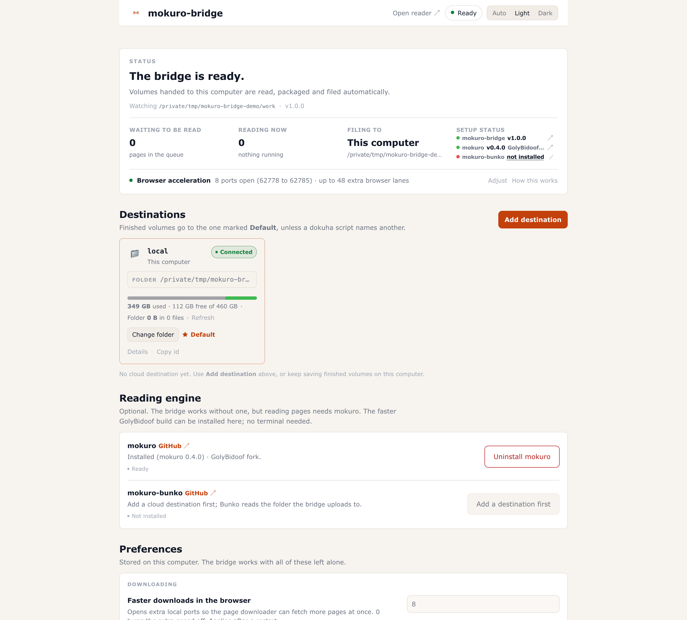

# Dashboard and status display

Two ways to see and change a running bridge without reading JSON by hand: a page the bridge serves itself, and a live terminal display. The page reads `/health` for live state, `/config` for the configuration it edits and `/config/engines` for the two optional engines; the terminal display reads `/health` only. Neither needs a restart to open.

## The web dashboard

Open the address the service prints at startup:

```
http://127.0.0.1:62642/
```

It is one self-contained page: inline CSS and JavaScript, inline SVG icons, no external assets, no CDN, no font download. It works offline and screenshots cleanly. The page is read from disk on every request (`Cache-Control: no-store`), so an edit to `mokuro_bridge/web/dashboard.html` shows up on reload without restarting a service that may be mid-upload. It polls `/health` every five seconds and reloads the configuration less often, and it pauses both while the tab is hidden.

Dark mode follows reader.mokuro.app: the `#030712` canvas, `#1f2937` header and panels, `#374151` borders, the `#ef562f` coral primary, white labels on coral buttons and Verdana throughout. The one deliberate divergence is the light theme: where the reader offers white or sepia, this page uses a warm-paper palette (`#f7f4ef` canvas, white panels) with a deeper coral (`#c2410c`) so links and buttons stay legible. A theme switch in the header offers Auto, Light and Dark; Auto is the default and follows the operating system, and the choice is remembered in `localStorage` under `mb-theme`. The chosen theme is applied before first paint, so reloading does not flash the wrong colours. The layout is responsive down to phone widths, and `prefers-reduced-motion` turns transitions off.



### What the page shows

| Area | Content |
| --- | --- |
| Header | Brand, an `Open reader` link to reader.mokuro.app, the status chip and the Auto/Light/Dark switch |
| Status chip | `Connecting…`, `Not connected`, `Ready`, or the live activity from `/health`: the stage (`ocr` or `uploading`) with its detail |
| Summary | A sentence about what the bridge is doing and four facts: pages waiting to be read, volumes reading now, the destination it files to (`This computer` when the local folder is the default), and a setup-status strip with the installed mokuro-bridge, mokuro and mokuro-bunko versions |
| Browser acceleration | The live `fetchProxyPorts` list: the port count, the first and last port and the extra browser lanes at six per port, or `off` when no ports are open. `Adjust` scrolls to and focuses `Faster downloads in the browser`, or explains that an environment variable pins it; `How this works` opens [browser-acceleration.md](browser-acceleration.md) |
| Notices | A banner when the bridge is not answering, when a newer version exists (with a release link and the `mokuro-bridge --update` command), when a sign-in is waiting in another tab (with Continue and Cancel), and when a destination needs signing in again (with a Reconnect button). A separate alert above Destinations appears only when the reading engine is missing, because that is the one thing that pauses work: OCR waits until mokuro is installed, while packaging and uploads keep going |
| Destinations | Only real accounts and the local destination are shown. A connected account is a card with its alias, provider brand glyph (a Google Drive triangle, M/O/W/R monograms for MEGA, OneDrive, WebDAV and rclone, or a folder glyph for local), note, account email when the bridge can look it up, folder with a provider link, state chip and default mark, a space row, and the actions below |
| Add a destination | The primary button in the Destinations section header, the single entry point to the provider picker |
| Reading engine | One card each for mokuro and mokuro-bunko: installed version and flavour, a state line (`Ready`, `Not installed`, `Installing…`, and for Bunko `Needs attention` when it follows a destination other than the default), an Install or Uninstall button, and the live log of the job. The setup-status strip carries the matching quick actions: Replace for an upstream mokuro, Update for a Bunko build that has moved |
| Preferences | The settings grouped as Downloading, Updates, Reading pages and Advanced, each with its source and a Save changes button |
| Footer | Version, a link to reader.mokuro.app, update state (`Checking for updates…`, `Up to date`, `Update checks are off`, `Could not check for updates` or the available version), and a Setup guide link. Developer details holds the raw `/health` and `/config` links, the terminal command, the settings file path, the engine, a `Faster engine` line with `mokuro-bridge --install-mokuro` when the loaded engine is the upstream build or missing, an optional `Library index` line for mokuro-bunko, and the fetch-proxy state |

On a first run, when no managed remote account exists, the Destinations section also shows a short note pointing at Add destination. The setup guide is the fuller onboarding.

### First run and the setup guide

On an interactive first run, when no account has been added, `mokuro-bridge` prints a short plain-language banner with the page address, a reminder to keep the window open and Ctrl-C to stop, then opens the setup page in the default browser after about a second. The technical startup lines (paths, engine, fetch-proxy ports) are behind `--verbose` or `MOKURO_BRIDGE_VERBOSE=1`. `--no-browser` or `MOKURO_BRIDGE_OPEN_BROWSER=0` stops the auto-open, and a service started by launchd, systemd or another manager has no terminal, so it never opens a browser.

The page's setup guide is click-only and has three screens: a welcome that offers to install a missing or slower engine, a choice between `On this computer` and `In the cloud`, and the provider picker when the cloud is chosen. The welcome explains in plain words that the bridge reads the pages, packages a volume and files it away, and offers mokuro without leaving the page, plus mokuro-bunko once a cloud destination exists. `Skip for now` closes the guide and remembers that it was seen in `localStorage` under `mb-wizard-seen`, so it does not nag; the footer's Setup guide link reopens it, and adding `?wizard=1` to the page URL forces it once and then clears the parameter. It opens by itself once, only while no managed remote account is configured. Choosing this computer finishes the guide with a toast and leaves the local destination as it is.

### Browser acceleration row

The summary has a `Browser acceleration` row that reads the live `fetchProxyPorts` list from `/health`. With ports open it shows the count, the first and last port, and the number of extra browser lanes at six per port; when the count is zero it says `off`. `Adjust` scrolls to and focuses `Faster downloads in the browser` in Preferences, or explains that the row is pinned by an environment variable, and `How this works` opens [browser-acceleration.md](browser-acceleration.md). That page covers the per-origin connection limit, why the port is part of the origin, the browser's own global connection ceiling and when to change the port count.

### Destinations on the page

A card is one destination: the local folder or one account. It shows the alias, a provider glyph, the note when one was set, the account address when a provider reports one, the folder with a link to the provider's file browser, a state chip (`Connected`, `Sign-in expired` or `Not connected`), the default mark, and a space row that reports real disk or quota figures for the local folder and rclone-backed accounts and says when a backend cannot report space. The actions are Connect or Reconnect, Change folder, Make default, Details, Rename and Remove, plus Copy id. The local destination has Change folder and Make default; Rename and Remove are for accounts only.

Connecting the first remote destination makes it the default, because a fresh install files locally until something else is chosen.

### Adding an account from the browser

The header's Add destination opens a provider picker with a card each for MEGA, Google Drive, OneDrive, WebDAV and an existing rclone remote. The page performs the four service sign-ins through rclone, so one rclone install covers the browser setup. Without rclone those four cards are disabled and their hint is the terminal command (`mokuro-bridge --setup-upload mega`, and the same for `drive`, `onedrive` and `webdav`), which runs the native form or flow described in [destinations.md](destinations.md). A card disabled for any other missing dependency names it.

- **MEGA** asks for the account email and password once, plus a two-factor code if the account uses one. The page creates the rclone remote, records the destination, then checks the sign-in in the background and reports the result as a toast; a remote that cannot sign in is deleted again, along with the account record.
- **Google Drive** opens Google's consent page in a new tab and finishes by itself when the tab is done. rclone's built-in Google client is enough for a new library; a collapsed `Use your own Google app (optional)` section takes a Client ID and Client secret plus a Google Cloud credentials link, so an existing reader library can be signed into with the same Google project that created it.
- **OneDrive** opens Microsoft's consent page in a new tab. rclone brings its own Microsoft app registration, so no Azure app registration is needed, and a personal Microsoft account works.
- **WebDAV** asks for the server address, username and password. A `Which server do you use?` picker (Nextcloud, ownCloud, Synology NAS, Box, pCloud, Strato HiDrive, or another server) fills in the address where the host is fixed and replaces the hint with that server's steps, and a `Where do I find this?` panel says where each server keeps its WebDAV address and when an app password is wanted. The address may be the server's web address or a bare host: the bridge adds the scheme (http when the host looks local). Advanced settings hold the upload folder. The page checks the sign-in in the background after saving and reports a refusal as a toast.
- **Existing rclone remote** lists the remotes already in `rclone config`, including S3 and other services, and takes a folder inside the chosen one. This is the only path that uses a remote you made yourself; the four cards above create their own.
- **Reconnect** from a card runs the same flow with the alias already filled in and keeps the account's folder, note and default.

A provider whose optional dependency is missing is reported with the reason and a link to the console that creates it. Each provider can hold any number of accounts: adding another of the same service is the same flow, and the name defaults to the next free alias.

### Managing destinations

- **Change folder** browses the provider's real folder tree through the provider's own API (`megatools ls` for a native MEGA account, `files.list` for native Drive, the children endpoint for native OneDrive, a `Depth: 1` `PROPFIND` for native WebDAV, `rclone lsf` for an rclone account). The chosen folder becomes that account's root, so later uploads land in `root/<series>/`. For the local destination it chooses the remembered local output folder, which applies to the next finalize. New folder is offered only in the local picker; it creates a directory under the same ingest roots the bridge already allows.
- **Make default** sets the sticky default. The starred target receives every upload until a client names another one. It applies to the next finalize and needs no restart.
- **Reconnect** appears when an account's saved sign-in has expired. It runs the sign-in again with the same alias and keeps the account's folder, note and default.
- **Rename** changes the alias and the note. Root, credentials and the default flag are preserved, and if the account was the default the sticky default follows the new alias. An alias already used by another account is refused.
- **Remove** deletes the saved sign-in and the account metadata. Files already uploaded are untouched and the local folder is never touched. For an rclone remote the page created, the rclone remote and its token go too; a remote you made yourself is left alone. If the removed account was the default, the sticky default is reset and the bridge falls back to its configured seed, which is the local destination unless `MOKURO_BRIDGE_UPLOAD_DEFAULT` names another target.
- **Copy id** copies `upload_method=<alias>`, which is the value a client passes to select that account.
- **Details** opens a dialog with the provider, account name and looked-up email when the destination is an account, the note, folder, status, an optional Library index line, a provider link and, for a native WebDAV account, the server address and whether its certificate is not verified. For the local destination the title is `This computer` and the account and email rows are omitted, leaving the provider, folder and status. Copy id sits in the dialog footer.

### Aliases and historical ids

Every upload account has an alias: `mega`, `mega-2`, `drive-next`. The alias is the account's `id` in `/config`, `/health` and `/upload-methods`, and the value clients pass as `upload_method` or `destination`.

- Aliases are 1 to 32 characters from lowercase letters, digits and hyphens, starting with a letter or digit. `local` is reserved, and another provider's bare name (`mega`, `drive`, `onedrive`, `webdav`, `rclone`) is reserved for that provider's first account.
- The first account of a provider is suggested as the bare provider name, later ones as `mega-2`, `mega-3`, and so on, skipping anything taken. The page prefills the suggestion; any free alias can be typed instead.
- Aliases are globally unique across providers. A duplicate on the add routes means "reconnect this account of this provider"; a duplicate across providers is refused unless you confirm the move.
- Historical spellings keep working as input forever: `mega`, `mega:work`, `drive:main` and `provider:default` all resolve to the same account, and a stored sticky default in an old spelling still resolves to the same account. Displays now show the alias, so an old `mega:work` appears as `mega-work`.
- Renaming changes only the alias. The storage name, root, note, credentials and keychain entries stay, and the legacy `provider:name` spelling keeps resolving. The freed old alias becomes available.

Accounts created before aliases existed derive one on read without their files being rewritten. The terminal setup commands still work as a fallback: `mokuro-bridge --setup-upload drive --name next` creates the account whose alias becomes `drive-next`, `--list-uploads` shows the ids and `--remove-upload drive-next` removes one.

### Settings storage and precedence

The page groups the settings it offers by what a person is actually doing:

| Group | Setting | What it changes | Validation | Applies |
| --- | --- | --- | --- | --- |
| Downloading | Faster downloads in the browser | How many extra local ports the page downloader may fetch through | Whole number from 0 to 256 | After a restart |
| Downloading | Pages fetched at the same time | How many upstream requests the accelerator makes at once; 0 means no cap | Whole number from 0 to 64 | After a restart |
| Updates | Check for updates | Whether the bridge asks GitHub whether a newer release exists; nothing is downloaded or installed | On or off | Immediately |
| Reading pages | Pages the OCR engine reads at once | The OCR batch size: bigger batches keep a fast machine busier, smaller ones suit tight memory | Whole number from 1 to 256 | After a restart |
| Advanced | Where finished volumes are saved on this computer | The fallback folder local copies are written to, with series folders inside it | Absolute path to an existing folder, or to a new folder whose parent exists and is writable | After a restart |
| Advanced | Other folders the bridge may read | Extra read roots, for a library that lives outside your home folder | Comma-separated absolute paths | After a restart |

The output-dir preference is the fallback used when no folder has been chosen for the local destination. Choosing a folder on the local destination card sets a remembered folder that applies immediately to the next finalize and takes precedence over this fallback. Every row except the update check is read when the process starts, so a change applies after the bridge restarts; each row's help ends with `Applies after a restart.` or `Applies immediately.` to say which. After a save the page is specific: a live-only change says no restart is needed, a restart-only change shows the restart command with a copy button, and a mixed save says which part is live and which needs the restart. The update check is read per request, so switching it off takes effect at once and the footer stops claiming a check is pending.

The groups keep the everyday switches (download speed, updates) above the set-once paths. The rest of the environment variables stay in `.env.example`: they are either security-sensitive (the bind address, CORS origins, the proxy's allowed hosts) or operational detail that a page should not be able to change under a running service.

The page writes to `~/.config/mokuro-bridge/settings.json` (override with `MOKURO_BRIDGE_SETTINGS_FILE`). Every reader asks in this order:

1. the environment variable, so a launchd plist or a shell export always wins,
2. the settings file, which is what the page writes,
3. the built-in default.

A row whose environment variable is set is disabled and labelled `Pinned by <VARIABLE>`. The save endpoint also skips an environment-pinned key when a write arrives from the page or from curl, so the stored file value is kept for the day the variable is unset and can never be clobbered by a save. Removing the variable and restarting is what makes the stored value take effect.

Rejected values are listed by label, for example `Where finished volumes are saved on this computer: is a file, not a folder; choose a folder or a new name inside an existing folder`, and nothing is written when any value is rejected. The file is plain JSON, hand-editable, written atomically with mode 0600, and holds no secrets. Everything else the bridge understands is set from the environment and documented in `.env.example`; a hand-edited settings file can carry those keys as well, and they apply.

### Writes are gated to this machine

The bridge is unauthenticated and loopback-only, and `CORS_ORIGINS` defaults to `*`, so any page in your browser can already reach it. Every configuration write (`/config/account`, `/config/default`, `/config/local-output`, `/config/new-folder`, `/config/settings`, `/config/forget`, every `/config/accounts/*` route and the engine install routes) checks the `Origin` header: a request from a loopback origin (`http://127.0.0.1:*`, `http://localhost:*`, `http://[::1]:*`) or with no `Origin` at all (curl, the CLI) is accepted, and anything else gets `403`. The Google Drive OAuth callback is a `GET` opened by Google's redirect, so it is not Origin-gated; it only accepts a one-time `state` created by this bridge. Reads are not gated, so a monitoring script can still poll. No response ever returns a credential, token or client secret.

## The terminal status display

```
mokuro-bridge --status
```

A self-refreshing full-screen view for when the service runs in the background under launchd or systemd and has no console of its own. It shows the engine and its tools, every destination with its alias and the default starred, the OCR queue, the pipeline and worker state, the proxy ports, what the bridge is doing right now, and a live upload progress bar while an upload is active, with file name, percent, bytes and speed. The bar is backed by the `upload` object `/health` reports while an upload is running and is omitted when nothing is uploading.

| Key | Action |
| --- | --- |
| `r` | Refresh now |
| `c` | Show the dashboard URL and what that page edits |
| `?` | Help overlay: the keys, the `★` default and `●`/`○` configured markers, and where settings are edited |
| `q` | Quit |

`?` and `c` leave the alternate screen, wait for a key, then re-enter it, and `q` quits from either. The display honours `NO_COLOR` and `TERM=dumb` (colour off, layout unchanged), re-reads the terminal size every frame so a resize is picked up, and measures display width with `wcwidth` when available and Unicode east-asian and combining rules otherwise, so CJK titles and combining marks do not break the frame. Borders, the header URL and the footer keep their corners down to 30 columns, and below 46 columns the layout switches to a compact body that still shows the status, the default destination, the worker state and the queue.

It reads `--status-url` (default `http://127.0.0.1:62642`, or `MOKURO_BRIDGE_HOST` / `MOKURO_BRIDGE_PORT`) and `--status-interval` seconds. `--status-url` accepts a bare `host:port`, adds the scheme once when it is missing, and brackets IPv6 literals. `--host` and `--port` are honoured when no URL is given. The fetch has a 3 second timeout and a failed fetch is reported inside the frame, with the command that starts the bridge, instead of ending the display; on a bridge that is not answering, a keypress can take up to that timeout to register. Piped output is one full-height frame with no escape sequences, so `mokuro-bridge --status | head -30` is a snapshot you can paste into an issue. The terminal is restored on exit, on Ctrl-C and on an exception.

## Related

- [endpoints.md](endpoints.md) documents the routes behind the page, including their error codes.
- [destinations.md](destinations.md) covers the destination model the page edits.
- [troubleshooting.md](troubleshooting.md) covers a page that will not load, sign-ins that need reconnecting and settings that need a restart.
- [browser-acceleration.md](browser-acceleration.md) explains the fetch-proxy ports behind the Browser acceleration row and the browser limits they run into.
- [architecture.md](architecture.md) has the module map.
